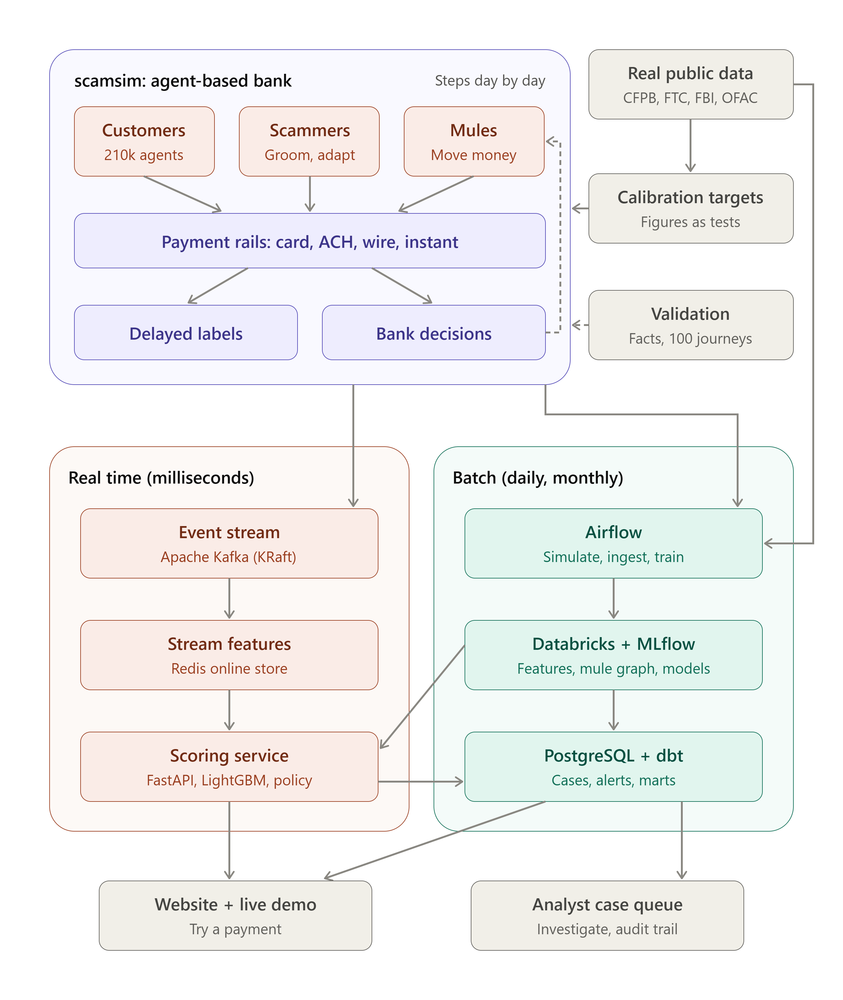

# Scam & Mule Defense Lab

Stopping scam payments before the money leaves, finding the accounts that receive it, and
measuring whether a bank's anti-money-laundering checks actually work, on instant payments.

> **Status: Phase 0 (foundations).** Repository, tooling, CI, local stack and design decisions.
> No models or results yet.

## What it is

A **simulated** mid-sized US bank, built from small computer "people" (agents) who behave like
real customers, scammers and money mules. The bank is defended along the whole chain:

| Part | What it does |
|---|---|
| Sending side | Scores each outgoing payment in under 100 ms and picks the cheapest sensible action: allow, warn, confirm payee, hold and call, or block |
| Warning experiment | A fair randomised A/B test of warnings, then an uplift model that shows each warning only where it changes behaviour |
| Refund rules simulator | Cost under today's US rules, a voluntary refund policy, and a UK-style 50/50 split between sending and receiving banks |
| Receiving side | Finds mule accounts on a payment network, measured by money stopped before it moves on |
| AML effectiveness | Rules versus machine-learning alert prioritisation, measured in real cases per analyst hour |
| Sanctions screening | Name matching against the real OFAC and OpenSanctions lists, measuring misses and false alarms |
| Threat intelligence | Real public data (CFPB, FTC, FBI IC3, FinCEN) on which scams are growing |



## What's real and what's simulated

No real bank transactions with scam labels are public anywhere: privacy law protects them, and
disclosing suspicious activity reports is a federal crime. So this project is honest about its
sources, and every output says which kind each result comes from.

| Layer | Real or simulated | Source |
|---|---|---|
| Scam complaints | Real | CFPB Consumer Complaint Database |
| Fraud loss, internet crime and SAR statistics | Real (totals) | FTC Consumer Sentinel, FBI IC3, FinCEN SAR Stats |
| Payment volumes | Real (totals) | Federal Reserve Payments Study, FedNow / RTP |
| Sanctions lists | Real | OFAC, OpenSanctions (non-commercial use) |
| Customers, accounts, payments, scams, mules | **Simulated** | `scamsim` (this repository), calibrated to the real totals above |
| Outside benchmark | Synthetic, public | IBM AMLworld (NeurIPS 2023) |

All people in the simulation are fake (generated names). Sanctions lists are only ever matched
against synthetic names. Nothing here explains how to get around fraud or AML controls. Rules
summaries are dated and are not legal advice.

## Repository layout

```
scamsim/     the agent-based simulated bank
intel/       real public data: downloads and cleaning
features/    feature definitions shared by batch and live code
models/      scam, mule, aml, screening, policy, refunds, uplift
serving/     scoring service and demo endpoint
streaming/   stream processors (Kafka -> Redis)
casemgmt/    case management database and API
common/      shared helpers (dev / ci / prod settings)
airflow/  databricks/  dbt/  site/  scripts/
docs/adr/    architecture decision records
```

## Run it locally

You need [uv](https://docs.astral.sh/uv/) and Docker Desktop.

```bash
uv sync                      # create .venv with Python 3.12 and the dev tools
uv run pre-commit install    # run the checks on every commit
uv run pytest                # tests

cp .env.example .env         # then set your own POSTGRES_PASSWORD in .env
docker compose -f docker-compose.yaml -f docker-compose.dev.yaml up -d --wait
docker compose -f docker-compose.yaml -f docker-compose.dev.yaml ps   # all three "(healthy)"
```

See [CONTRIBUTING.md](CONTRIBUTING.md) for the dev / prod set-up and how changes get merged.

## Design decisions

- [ADR 0001: Simulated data, with scamsim as an agent-based model](docs/adr/0001-simulated-data-and-agent-based-scamsim.md)
- [ADR 0002: Streaming stack: Apache Kafka and Redis](docs/adr/0002-streaming-stack-kafka-and-redis.md)
- [ADR 0003: PostgreSQL versus Snowflake](docs/adr/0003-postgresql-vs-snowflake.md)
- [ADR 0004: Oracle VM memory budget alongside Bank Health](docs/adr/0004-oracle-vm-memory-budget.md)

## Licence and credits

MIT licence ([LICENSE](LICENSE)). Built with AI-assisted coding; the design, analysis and review
are my own.
